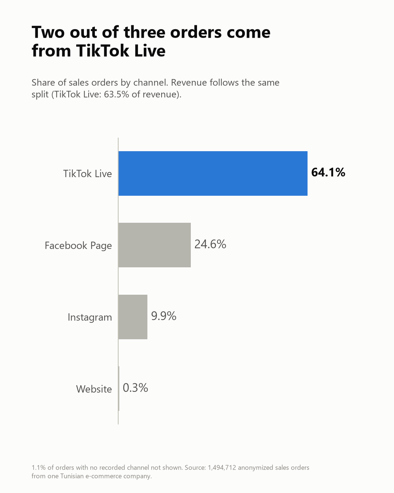
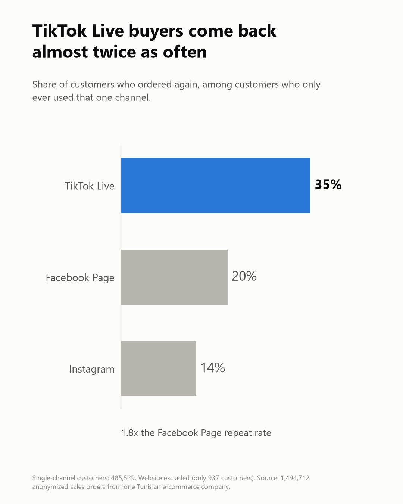
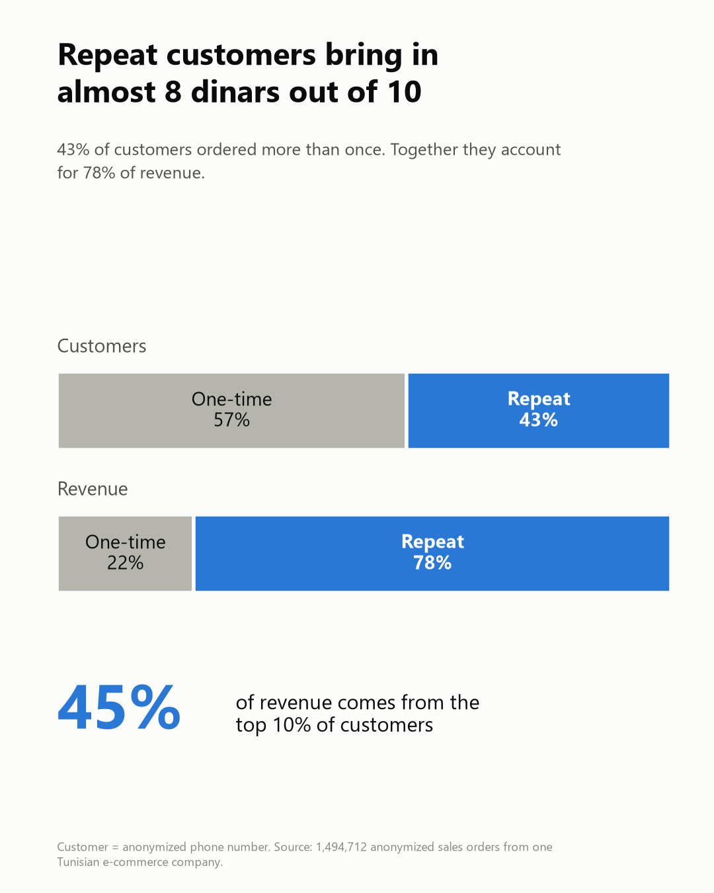
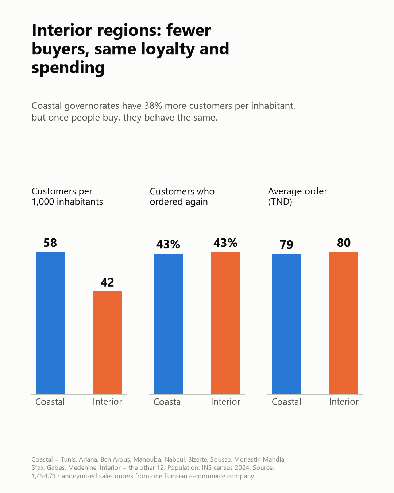
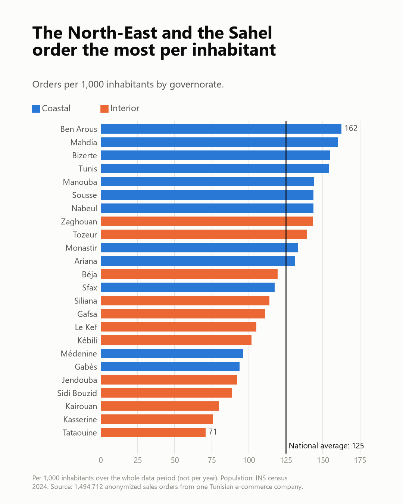
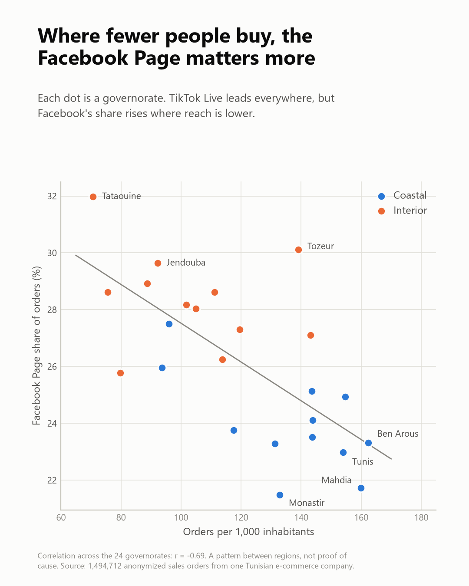
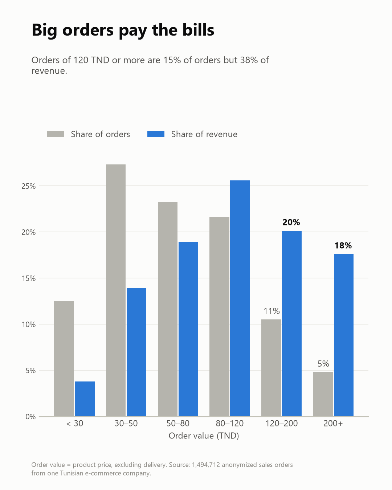

# How Tunisians buy on social media

**An analysis of 1.5 million social-commerce orders, for small sellers and e-commerce startups in Tunisia.**

> **The data is private.** A Tunisian e-commerce company shared its order history with me and approved publishing
> aggregated and anonymized findings without being named. This repository contains **code, charts and
> aggregated tables only**: no raw data, no customer-level data, and no group smaller than 50 orders.



## The question

Social commerce (selling through TikTok lives, Facebook pages and Instagram) is how a large share of Tunisian
online shopping happens, but small sellers rarely see numbers about it. This project asks:

1. **Channels:** which channels bring orders and revenue, and do baskets differ?
2. **Geography:** where do people buy, relative to population? Is there a coastal/interior gap?
3. **Channel × region:** does the dominant channel change across governorates?
4. **Loyalty:** how many customers come back, and how concentrated is revenue?
5. **Baskets:** what do orders typically cost, by channel and region?
6. **(Estimated) gender:** who places the orders?

The data has no dates and no product information, so there is no time-trend or product analysis.

## Key findings

| # | Finding | Evidence |
|---|---|---|
| 1 | **TikTok Live brings two out of three orders.** | 64.1% of orders, 63.5% of revenue. Facebook Page 24.6%, Instagram 9.9%, website 0.3%. |
| 2 | **TikTok Live buyers come back almost twice as often.** | Among customers who used one channel only, 35.3% ordered again on TikTok Live vs 19.8% on the Facebook Page and 13.9% on Instagram. |
| 3 | **Repeat customers bring in almost 8 dinars out of 10.** | 43.1% of customers ordered more than once and account for 77.7% of revenue. The top 10% of customers bring 45.1%. |
| 4 | **The interior gap is reach, not spending.** | Coastal governorates have 38% more customers per inhabitant (57.6 vs 41.9 per 1,000), but the same repeat rate (43.0% vs 43.4%) and the same average order (78.8 vs 79.8 TND). |
| 5 | **TikTok Live leads everywhere; Facebook matters more where reach is lower.** | TikTok Live is #1 in all 24 governorates (58.3% to 68.6%). Facebook Page share: 23.8% coastal vs 28.1% interior; across governorates it falls as orders per inhabitant rise (r = −0.69). |
| 6 | **Big orders pay the bills.** | Orders of 120 TND or more are 15.3% of orders but 37.8% of revenue. 39.8% of orders are under 50 TND; median order 62.8 TND. |
| 7 | **Women's names are on at least 8 in 10 orders** *(estimated)*. | 95.9% of classifiable names are women's names; even if every unclassified name were a man's, the share would be 82.1%. |

<p>



</p>
<p>



</p>

**What a small seller can take from this**

- Go live on TikTok: it brings most orders *and* the most loyal buyers.
- Win the second sale: repeat buyers are where the revenue is.
- Don't write off the interior: fewer people buy there, but those who do spend and come back just as much.
- Outside the big coastal cities, keep a Facebook Page active.
- Offer bundles or premium items alongside cheap ones: a minority of large orders carries a large share of revenue.

The full carousel is in [`outputs/carousel/`](outputs/carousel/tunisia_social_commerce_carousel.pdf).

## Data and privacy

| | |
|---|---|
| Source | One Tunisian e-commerce company's order export, shared with permission. The company is not named. |
| Raw file | 3,150,576 rows → **1,560,668 unique orders** after removing exact duplicate rows (an export artefact). |
| Scope of most analyses | **1,494,712 sales orders** from **623,661 customers**: complaint follow-ups (64,853 orders, mostly 0 TND) and 1,103 other zero-value orders are excluded. |
| Columns used | Order value (product price, no delivery fees), sales channel, governorate, customer phone, customer name. |

Privacy rules applied throughout:

- **The raw file never entered this project folder**; it was read in place.
- **Anonymization first** ([`scripts/01_anonymize.py`](scripts/01_anonymize.py)): the analysis file keeps only a customer ID,
  order value, channel, governorate and an estimated gender. Names, phone numbers, addresses and order IDs are dropped.
- **Customer ID = HMAC-SHA256 of the phone number with a secret salt.** Tunisian mobile numbers have only 8 digits,
  so a plain hash could be reversed by hashing all 100 million numbers; the secret salt (never committed) prevents that.
- **Rows are shuffled** before saving so file order leaks nothing.
- **No published group is smaller than 50 orders**: [`src/common.py`](src/common.py) refuses to save a table that breaks this rule.
- The data was only ever inspected through aggregates (counts, distributions, null rates), never row by row.

## Method

| Step | Script | What it does |
|---|---|---|
| 0 | [`00_profile.py`](scripts/00_profile.py) | Aggregate-only profile of the raw file (found the duplicate rows). |
| 1 | [`01_anonymize.py`](scripts/01_anonymize.py) | Deduplicate, hash, normalize channel and governorate, estimate gender, write the anonymized file. |
| 1b | [`01b_summarize_anon.py`](scripts/01b_summarize_anon.py) | Summary statistics and privacy checks on the anonymized file. |
| 2 | [`02_channels.py`](scripts/02_channels.py) | Channel performance. |
| 3 | [`03_geography.py`](scripts/03_geography.py) | Orders and customers per 1,000 inhabitants; coastal vs interior. |
| 4 | [`04_channel_by_region.py`](scripts/04_channel_by_region.py) | Channel mix by governorate. |
| 5 | [`05_repeat_customers.py`](scripts/05_repeat_customers.py) | Repeat rates, revenue concentration, single-channel robustness check. |
| 6 | [`06_basket_distribution.py`](scripts/06_basket_distribution.py) | Price bands by channel and region. |
| 7 | [`07_gender_estimated.py`](scripts/07_gender_estimated.py) | Estimated gender split and behaviour. |
| 8–9 | [`08_charts.py`](scripts/08_charts.py), [`09_carousel.py`](scripts/09_carousel.py) | Charts and LinkedIn carousel, built **only** from the published tables. |

Key decisions:

- **Channels.** Raw codes were mapped with the company: `Live` = TikTok Live, `Page` = Facebook Page, `0` and
  `Instagram` = Instagram, `Shopify` = website. "Réclamation" (complaint follow-ups) is not a sales channel and is excluded.
- **Governorates.** 337 raw spellings were normalized to the 24 official governorates (exact match, aliases,
  city names, typo-tolerant matching, then the address as a last resort); 69 orders (0.004%) stay Unknown.
- **Population.** Institut National de la Statistique, *RGPH 2024 — Bilan Démographique* (May 2025), p.15
  ([`reference/ins_population_2024.csv`](reference/ins_population_2024.csv)); checked against the printed national and district totals.
- **Coastal vs interior.** The socio-economic *littoral / intérieur* split: Tunis, Ariana, Ben Arous, Manouba, Nabeul,
  Bizerte, Sousse, Monastir, Mahdia, Sfax, Gabès and Médenine are coastal; the other 12 are interior.
- **Repeat rate by channel** is measured within each channel, and confirmed on customers who only ever used one
  channel, so TikTok's larger volume cannot explain its higher loyalty.
- **Gender** is estimated from the first word of the name, using a dictionary written from general knowledge
  ([`reference/first_names_gender.csv`](reference/first_names_gender.csv)) plus manual labels for frequent names
  (kept private). Unisex or unknown names stay "unknown" (coverage: 85.7% of orders). A second-word fallback was
  dropped because Tunisian names often put the father's name second, which biased results towards men.

## Limitations

- **One company.** The channel mix reflects this company's own strategy and audience, not the whole Tunisian market.
- **No dates.** All rates cover the full period of the export, not a year; "per 1,000 inhabitants" is not annual.
- **Patterns, not causes.** E.g. the Facebook/reach correlation is across 24 governorates and does not say why.
- **Customer = phone number.** One person with two phones counts twice; a shared phone counts once.
- **Instagram baskets** are distorted by one dominant offer (57% of orders under one Instagram code sit at three
  exact prices), so Instagram's higher median basket is not presented as buyer behaviour.
- **Gender is a rough estimate.** The name on an order may be the recipient's rather than the buyer's.
- Population denominators include all ages, so per-inhabitant figures compare regions; they are not shares of shoppers.

## Repository structure

```
scripts/            analysis pipeline (run in order)
src/                shared helpers: normalization, gender estimate, publication rule, chart style
reference/          public reference data: INS population, first-name dictionary
outputs/tables/     every published number, as aggregated CSV tables
outputs/charts/     one chart per finding (1080 x 1350)
outputs/carousel/   LinkedIn carousel (PDF)
```

## Reproducing

The raw data is private and not included, so the pipeline cannot be re-run from this repository. With access to
the export, the steps are:

```bash
python -m venv .venv && .venv/Scripts/pip install -r requirements.txt   # Python 3.13
python scripts/01_anonymize.py <path-to-raw-export.csv>
python scripts/02_channels.py      # ...then 03 to 09 in order
```

## Tools and AI use

Python 3.13, pandas, pyarrow and matplotlib. I used AI tools (Claude Code) to write the code and build the visuals.
The questions, the decisions on data handling, the validation of results and the conclusions are mine.
